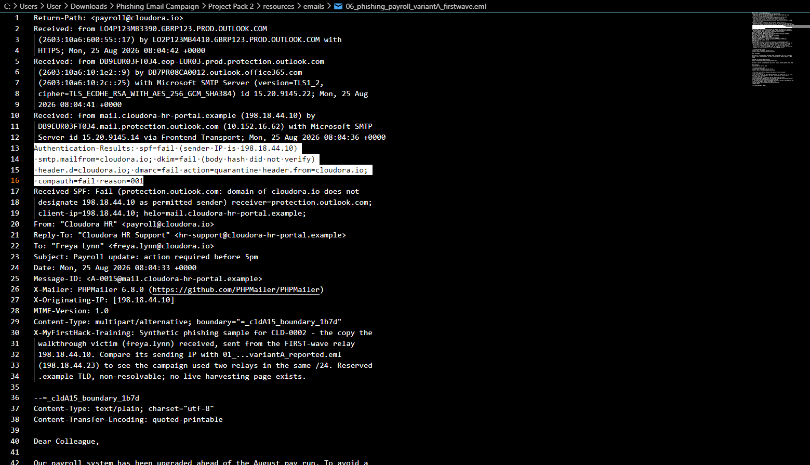
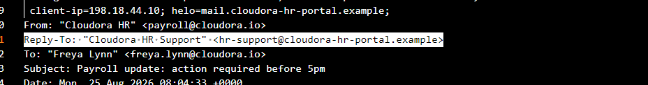
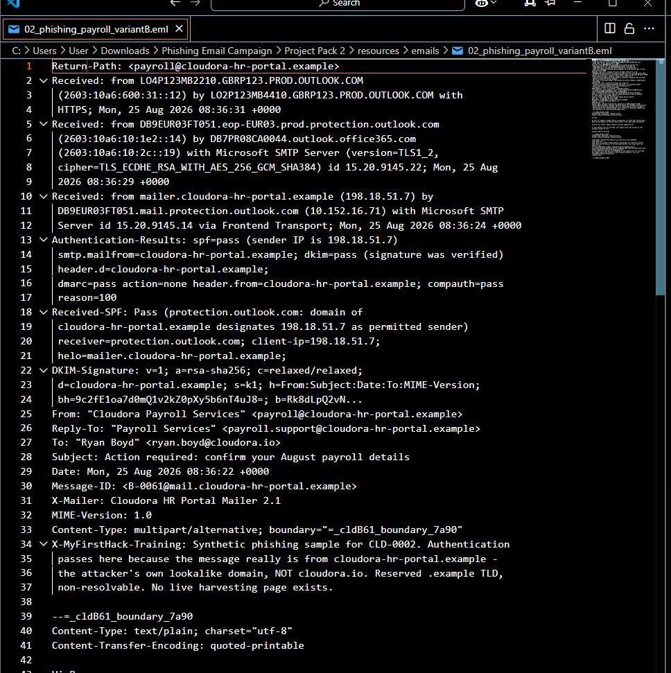
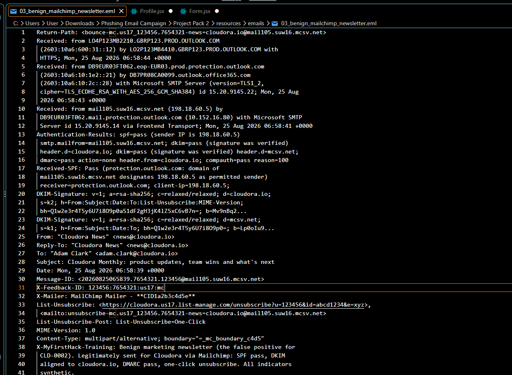
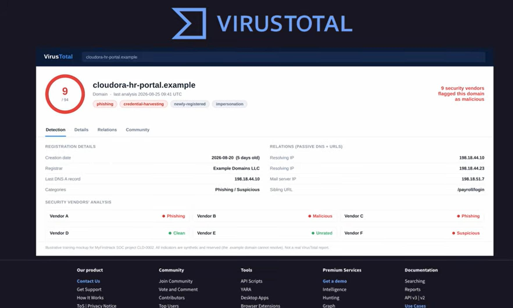
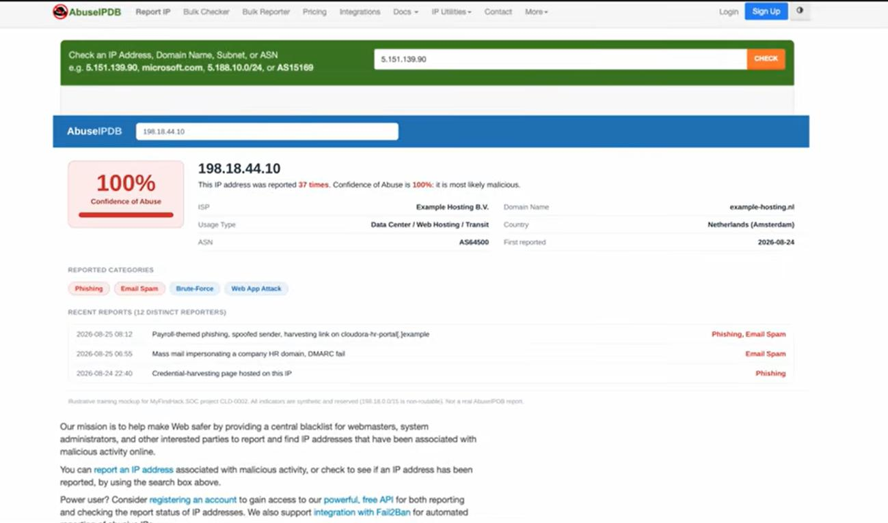
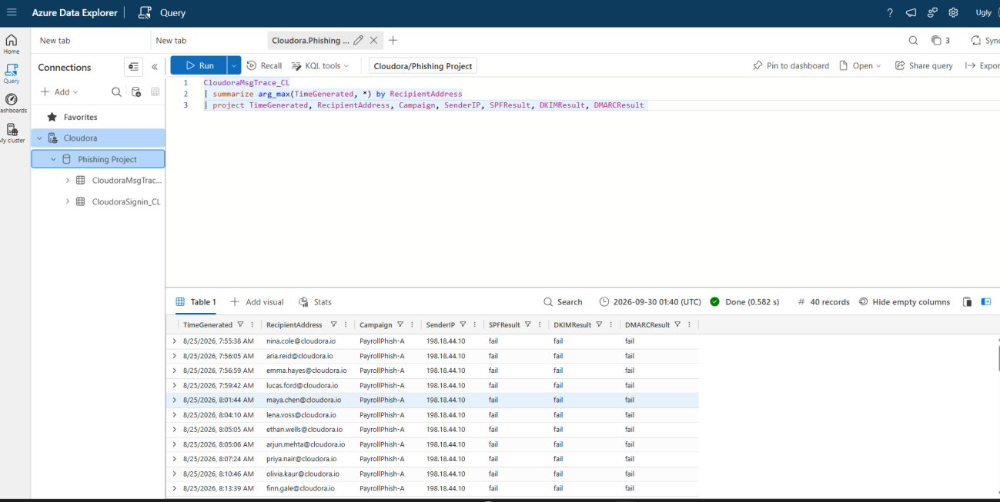
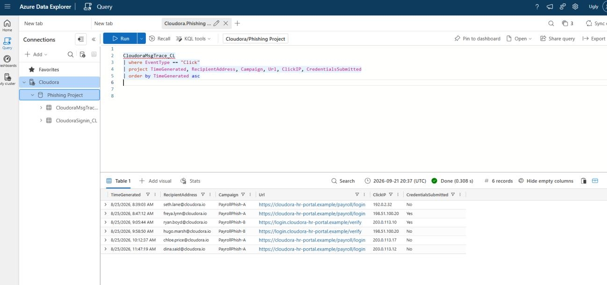
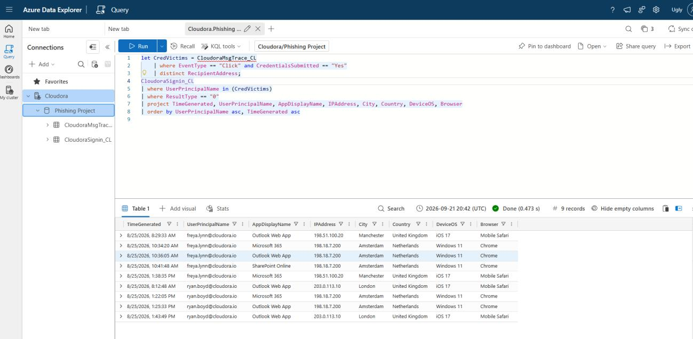
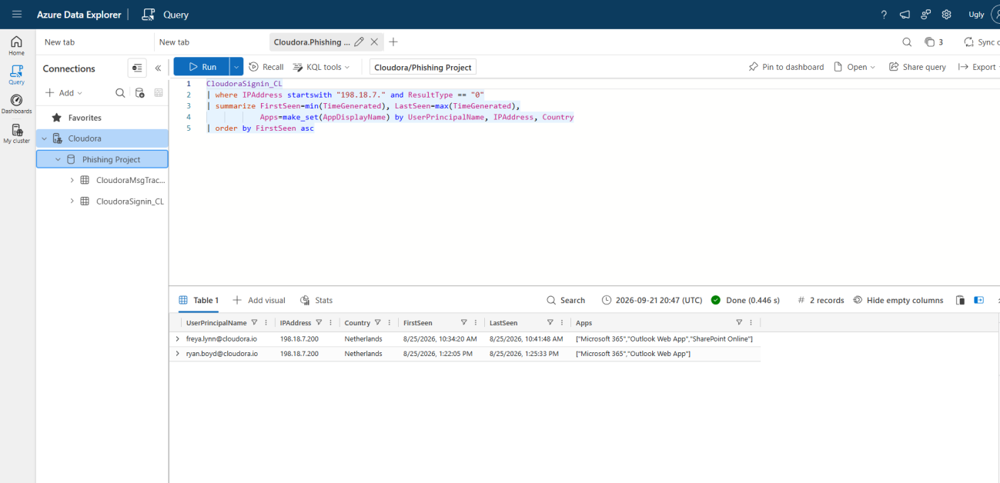

# Cloudora Phishing Campaign Investigation

A payroll-themed phishing campaign hit a fictional London HR and payroll software company called Cloudora. I started with the raw emails, worked out who received them, who clicked, and who gave away their password, and then checked the identity logs to see whether those passwords were actually used.

## Incident at a glance

| | |
|---|---|
| Incident ID | CLD-0002 |
| Priority | P1 |
| Type | Phishing campaign and account compromise |
| Environment | Microsoft Entra ID, Azure Data Explorer, VS Code |
| Tools | VS Code (raw .eml review), KQL, VirusTotal, AbuseIPDB |
| Targeted | 40 employees |
| Clicked the link | 6 |
| Submitted credentials | 2 (Freya and Ryan) |
| Accounts compromised | 2, both signed into from the same Amsterdam IP |

## What is in this repo

- [`Cloudora_Phishing_Investigation_CLD-0002.pdf`](Cloudora_Phishing_Investigation_CLD-0002.pdf): the full step-by-step investigation, with queries and evidence ([Markdown version](Cloudora_Phishing_Investigation_CLD-0002.md))
- [`Cloudora_Incident_Report_CLD-IR-0002.pdf`](Cloudora_Incident_Report_CLD-IR-0002.pdf): the shorter incident report with timeline, IOCs, MITRE ATT&CK mapping, actions taken and recommendations ([Markdown version](Cloudora_Incident_Report_CLD-IR-0002.md))
- [`images/`](images): the screenshots used below

## How I approached it

I followed an evidence-first order. I looked at the emails before any threat intelligence, then used VirusTotal and AbuseIPDB only as supporting context, then moved to message trace and finally to sign-in logs. Each step answered one question and led to the next.

### 1. Were the emails malicious?

I had three samples: two phishing variants and one legitimate newsletter. I read the raw .eml files in VS Code so I never had to open them in a mail client.

Variant A claimed to be from payroll@cloudora.io, but the Reply-To pointed to a lookalike domain, cloudora-hr-portal.example. Cloudora's real HR portal is myhr.cloudora.io. SPF, DKIM and DMARC all failed.

Variant B was the interesting one. It passed SPF, DKIM and DMARC, but it passed them for the attacker's own lookalike domain, not for Cloudora. That taught me that authentication proves which domain sent a message, not that the domain can be trusted.

The legitimate newsletter also passed everything, but its DKIM signature was aligned with cloudora.io and the second signature came from Mailchimp's infrastructure. It was a false positive and I cleared it.

| | Variant A | Variant B | Newsletter |
|---|---|---|---|
| SPF, DKIM, DMARC | Fail | Pass | Pass |
| Domain | Lookalike | Lookalike | cloudora.io |
| Verdict | Phishing | Phishing | Legitimate |

### 2. What infrastructure was behind it?

The headers gave me one lookalike domain and three sending IPs. I then checked them in VirusTotal and AbuseIPDB. I treated both as supporting intelligence, not proof on their own, and an abuse confidence score of 100 does not mean a 100% chance that an IP is malicious.

### 3. Who received it, and who interacted with it?

Message trace data showed that 40 employees were targeted. Receiving an email is not the same as interacting with it, so I split people into three groups: received, clicked, and submitted credentials.

Six people clicked the link. Four only clicked. Two, Freya and Ryan, also submitted their credentials.

### 4. Were the stolen credentials used?

I took the two people who submitted credentials and looked for successful sign-ins to their accounts in Entra ID.

Both accounts had a normal sign-in from an iPhone in the UK earlier that day (Freya from Manchester, Ryan from London). Later, both were signed into from the same IP address in Amsterdam, 198.18.7.200, on Windows and Chrome. The unfamiliar location, device and browser, plus the timing after credential submission, made these sign-ins suspicious. Freya's case also fit an impossible travel pattern. I treated that as an indicator, not proof, because VPNs and inaccurate geolocation can look the same.

### 5. Was anyone else affected?

I searched every successful sign-in from the attacker IP range. It returned only Freya and Ryan, so the confirmed suspicious access was limited to those two accounts. Pivoting from the first victim is what surfaced the second.

## Timeline

All times UTC, 25 August 2026.

| Time | Event |
|---|---|
| 08:04 to 08:50 | Phishing waves sent (variant A, then variant A wave 2 and variant B) |
| 08:47 | freya.lynn clicks and submits credentials |
| 09:05 | ryan.boyd clicks and submits credentials |
| 09:11 | A staff member reports the email and the ticket is raised |
| 10:34 | Attacker signs in as freya.lynn from 198.18.7.200 |
| 13:22 | Attacker signs in as ryan.boyd from the same IP |
| About 14:00 | Containment recommended for both accounts |

## Indicators of compromise

| Type | Value |
|---|---|
| Domain | cloudora-hr-portal.example |
| IPv4 | 198.18.44.10 |
| IPv4 | 198.18.44.23 |
| IPv4 | 198.18.51.7 |
| IPv4 | 198.18.7.200 (attacker sign-in IP) |
| Sender | payroll@cloudora.io (spoofed) |
| Sender | payroll@cloudora-hr-portal.example |
| Subject | Payroll update: action required before 5pm |
| Subject | Action required: confirm your August payroll details |

## MITRE ATT&CK mapping

| Tactic | Technique |
|---|---|
| Initial Access | T1566.002 Phishing: Spearphishing Link |
| Reconnaissance | T1598.003 Phishing for Information: Spearphishing Link |
| Initial Access | T1078.004 Valid Accounts: Cloud Accounts |

## Recommended response

In order: revoke sessions and refresh tokens, reset credentials, re-register MFA, block the phishing infrastructure, purge the phishing emails, then re-run the queries to prove the attacker is gone. The order matters. A password reset alone leaves an attacker's open session working, so revoking the sessions come first.

## What I learned

- Passing SPF, DKIM and DMARC does not make an email safe. The question is which domain it passes for.
- Lookalike domains still work, so the whole domain matters, not just the name in the From line.
- Email evidence alone would not have shown the real impact. I needed email, message trace, credential submission and sign-in logs together.
- Never stop at the first victim. Pivoting on the attacker IP found the second account.
- The gap to close is detection speed. A rule for a foreign sign-in shortly after a phishing click would have flagged both accounts automatically.

## Resources

### My KQL queries

The four queries behind the investigation are saved in [`queries/`](queries), in the order I ran them:

| Query | Question it answers |
|---|---|
| [`01_message_trace_delivery.kql`](queries/01_message_trace_delivery.kql) | Who received the phishing emails? |
| [`02_click_analysis.kql`](queries/02_click_analysis.kql) | Who clicked, and who submitted credentials? |
| [`03_credential_victim_signins.kql`](queries/03_credential_victim_signins.kql) | Were the submitted credentials used to sign in? |
| [`04_attacker_ip_pivot.kql`](queries/04_attacker_ip_pivot.kql) | Did the attacker IP touch any other account? |

### Tools and references

| Resource | Used for |
|---|---|
| Azure Data Explorer | Running the KQL queries |
| KQL reference | Query language documentation |
| VirusTotal | Domain and infrastructure enrichment (mock-up supplied with the scenario) |
| AbuseIPDB | IP reputation enrichment (mock-up supplied with the scenario) |
| MITRE ATT&CK | Technique mapping |
| NIST SP 800-61 | Incident response lifecycle mapping |

## Scenario credit

The scenario, company and datasets come from a MyFirstHack training project. The analysis and write-up are my own.
